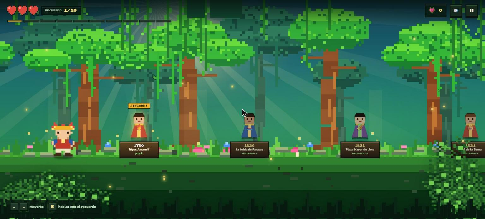
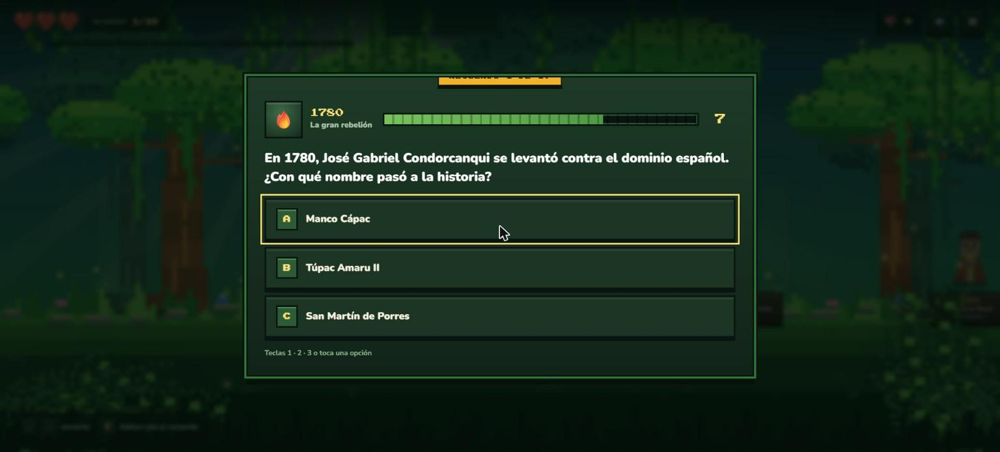
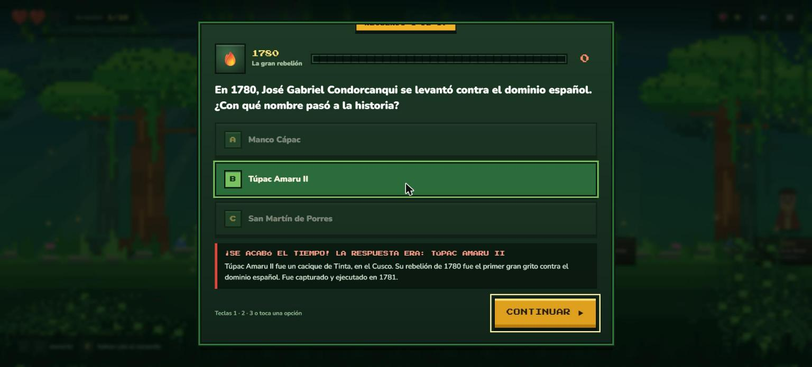

# 🌿 Memoria Libre

**Videojuego educativo en pixel art para aprender y recordar la Independencia del Perú (1780 – 1826).**
Pensado para exploradores de **9 a 13 años**. Corre en cualquier navegador, sin instalar nada.


---

## 💡 ¿De qué trata?

El jugador camina por una selva ilustrada en pixel art. A lo largo del camino encuentra **10 "recuerdos"**: personajes y lugares clave de la independencia, en orden cronológico (Túpac Amaru II, el desembarco en Paracas, la proclamación en Lima, Junín, Ayacucho…). Al llegar a cada uno responde una pregunta con tiempo límite. Cada acierto da una **fruta** y un **dato curioso** que explica la respuesta, así se aprende también cuando se falla.

La idea es que aprender historia se sienta como jugar una aventura, no como estudiar una lista de fechas.

## 🎮 Cómo se juega

1. **Camina** con las flechas `←` `→` o con los botones en pantalla (en celular). También puedes tocar un recuerdo para ir hacia él.
2. **Despierta el recuerdo** al llegar y responde en **10 segundos** (teclas `1` `2` `3` o tocando una opción).
3. Cada acierto da una **fruta peruana** (tuna, mango, lúcuma, cacao, maracuyá, granadilla). Tienes **3 vidas**.
4. Si pierdes las 3 vidas aparece la **ronda de rescate**: 3 preguntas fáciles de 5 segundos. Con 2 aciertos recuperas una vida y sigues.
5. Al completar los 10 recuerdos ganas la **insignia** y se desbloquea el siguiente bloque.

### Mapa de bloques

Cinco bloques de historia del Perú. Hoy está jugable el Bloque 1; los demás aparecen bloqueados hasta completar el anterior y muestran "próximamente".


| Bloque | Tema | Período |
|---|---|---|
| 1 | La Independencia del Perú ✅ jugable | 1780 – 1826 |
| 2 | Los Incas y el Tahuantinsuyo | Siglos XIII – XVI |
| 3 | Conquista y Virreinato | 1532 – 1821 |
| 4 | La República y sus héroes | 1826 – 1900 |
| 5 | Perú diverso y moderno | 1900 – hoy |

### El mundo

Un escenario con capas de parallax, luciérnagas y hojas cayendo. Cada recuerdo es un personaje con su cartel (año y lugar). Los ya completados quedan marcados con ✔ y se pueden tocar para releer su dato.



### Preguntas y datos curiosos

Cada pregunta tiene un cronómetro visible y tres opciones que se **mezclan en cada partida**. Después de responder, el juego muestra la respuesta correcta y un dato que explica el porqué.

| Pregunta | Respuesta con dato curioso |
|---|---|
|  |  |

## 🧠 Cómo ayuda a recordar

- **Orden cronológico:** los 10 recuerdos siguen la línea de tiempo, lo que ayuda a ubicar cada hecho.
- **Repaso espaciado:** el modo **Repaso** arma 5 preguntas priorizando las que el jugador falló, y el menú le avisa cuántos días pasaron desde la última práctica.
- **Dominio por recuerdo:** el juego guarda cuántas veces se acertó cada pregunta y muestra el progreso en el mapa.
- **Ronda de rescate:** da una segunda oportunidad con datos concretos, para no frustrar a quien se equivoca.
- **Resumen final:** muestra aciertos, errores, tiempo y "lo que aprendiste", una frase por cada recuerdo.

## ♿ Detalles de diseño

- Interfaz y contenido 100 % en español.
- Funciona en computadora y celular (controles táctiles).
- Roles ARIA en los diálogos, etiquetas en los botones y foco por teclado en las opciones.
- Efectos de sonido generados con Web Audio (sin archivos de audio), con botón para silenciar.
- El progreso (frutas, insignias, recuerdos dominados) se guarda en el navegador con `localStorage`; no hay cuentas ni servidor.

## 🛠️ Tecnología

HTML, CSS y JavaScript puro, sin frameworks ni dependencias.

- Los sprites y fondos del juego son **SVG generados por código** (`js/sprites.js`, `js/scene.js`), por eso no hay imágenes que cargar.
- Fuentes de Google Fonts: *Press Start 2P* y *Nunito*.

```
index.html        Pantallas: menú, bloques, juego, resumen, derrota, rescate y modales
css/style.css     Estilos y animaciones
js/data.js        Contenido histórico: bloques, 10 preguntas con datos curiosos y banco de rescate
js/sprites.js     Personajes, frutas e insignias en pixel art
js/scene.js       Capas del paisaje (cielo, montañas, árboles, lianas)
js/app.js         Lógica: mundo, movimiento, preguntas, vidas, rescate, repaso, guardado y sonido
docs/img/         Capturas usadas en este README
```

## ▶️ Cómo ejecutarlo

No requiere build. Abre `index.html` en el navegador, o sirve la carpeta con cualquier servidor estático:

```bash
npx serve .
```

## ✏️ Cómo agregar contenido

Todo el contenido está en `js/data.js`. Para añadir una pregunta se agrega un objeto a `QUESTIONS`; **la respuesta correcta va siempre primero** en `options` (el juego las mezcla solo):

```js
{
  id: 'q11',
  year: '1824',
  name: 'Título del recuerdo',
  icon: '⚔️',
  scene: 'Lugar o personaje',
  question: '¿Pregunta?',
  options: ['Correcta', 'Distractor 1', 'Distractor 2'],
  fact: 'Dato curioso que se muestra tras responder.',
  learn: 'Frase corta para el resumen final.',
  fruit: 'mango'
}
```

## 🚧 Estado y próximos pasos

- ✅ Bloque 1 completo: 10 recuerdos, rescate, repaso, insignia y guardado local.
- 🔜 Bloques 2 a 5 (Incas, Conquista y Virreinato, República, Perú diverso).

## 👥 Equipo

Proyecto del equipo **3for** · categoría Educación.
