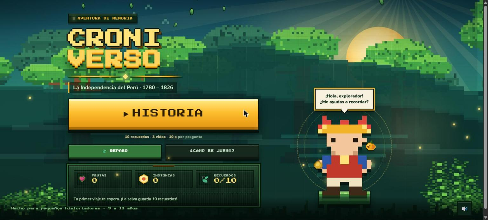
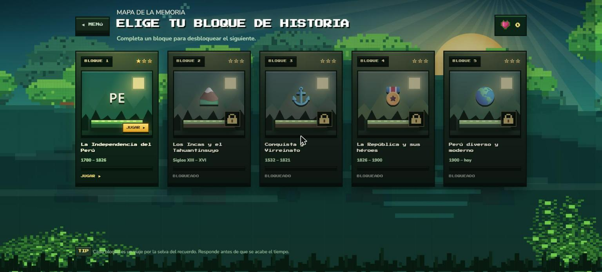
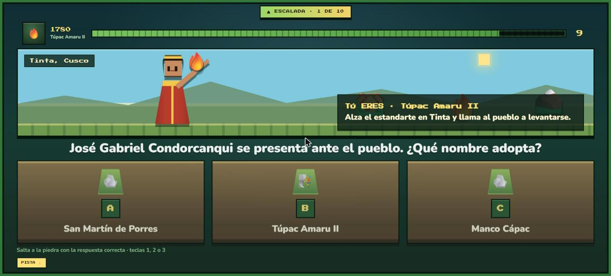
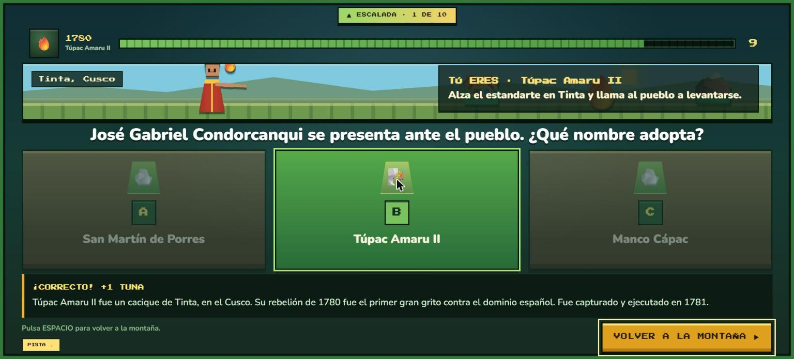

# 🌿 Croniverso

**Videojuego educativo en pixel art para aprender y recordar la Independencia del Perú (1780 – 1826).**
Pensado para exploradores de **9 a 13 años**. Corre en cualquier navegador, sin instalar nada.



---

## 💡 ¿De qué trata?

El jugador camina y sube por un paisaje andino ilustrado en pixel art. A lo largo del camino encuentra **10 "recuerdos"**: personajes y lugares clave de la independencia, en orden cronológico (Túpac Amaru II, el desembarco en Paracas, la proclamación en Lima, Junín, Ayacucho…). Al llegar a cada uno responde una pregunta con tiempo límite. Cada acierto da una **fruta** y un **dato curioso** que explica la respuesta, así se aprende también cuando se falla.

La idea es que aprender historia se sienta como jugar una aventura, no como estudiar una lista de fechas.

## 🎮 Cómo se juega

1. **Camina** con las flechas `←` `→` o con los botones en pantalla (en celular). También puedes tocar un recuerdo, o usar el botón "Ir al recuerdo", para acercarte.
2. **Entra al recuerdo** pulsando `ESPACIO` (o el botón "Entrar al recuerdo"): te conviertes en el personaje y ves su escena.
3. **Responde en 10 segundos** (teclas `1` `2` `3` o tocando una opción). Si dudas, el botón **PISTA 💡** te da una ayuda.
4. Pulsa `ESPACIO` otra vez para **volver a la montaña** y seguir subiendo.
5. Cada acierto da una **fruta peruana** (tuna, mango, lúcuma, cacao, maracuyá, granadilla). Tienes **3 vidas**.
6. Si pierdes las 3 vidas aparece la **ronda de rescate**: 3 preguntas fáciles de 5 segundos. Con 2 aciertos recuperas una vida y sigues.
7. Al completar los 10 recuerdos ganas la **insignia** y se desbloquea el siguiente bloque.

### Mapa de bloques

Cinco bloques de historia del Perú. Hoy está jugable el Bloque 1; los demás aparecen bloqueados hasta completar el anterior y muestran "próximamente".



| Bloque | Tema | Período |
|---|---|---|
| 1 | La Independencia del Perú ✅ jugable | 1780 – 1826 |
| 2 | Los Incas y el Tahuantinsuyo | Siglos XIII – XVI |
| 3 | Conquista y Virreinato | 1532 – 1821 |
| 4 | La República y sus héroes | 1826 – 1900 |
| 5 | Perú diverso y moderno | 1900 – hoy |

### El mundo

El camino **sube por los Andes**: cada recuerdo queda más arriba que el anterior y la cámara acompaña la subida, con montañas nevadas, capas de parallax, luciérnagas y hojas cayendo. Cada recuerdo es un personaje con su cartel (año, nombre y la acción que realiza, como "SE REBELA" o "DESEMBARCA"). Los ya completados quedan marcados como **RECORDADO** y se pueden tocar para releer su dato.


### Ser el personaje: escenas de acción

Al entrar a un recuerdo el jugador **se convierte en el personaje histórico** ("Tú eres · Túpac Amaru II"). Se abre una escena con el lugar (por ejemplo "Tinta, Cusco"), una figura animada y una frase que cuenta qué está haciendo, y a partir de ahí se plantea la pregunta como parte de la historia.



### Preguntas como minijuegos

Cada pregunta tiene un cronómetro visible y tres opciones que se **mezclan en cada partida**. Las opciones se presentan como un minijuego distinto, que rota por recuerdo, para que no se sientan como un examen repetido:

| Minijuego | Pista en pantalla |
|---|---|
| **ESCALADA** | Salta a la piedra con la respuesta correcta |
| **QUIPU** | Ata el nudo que guarda el dato correcto |
| **TEMPLO** | Abre la puerta que revela la respuesta |
| **RESCATE** | Elige rápido la pista correcta (ronda de 5 segundos) |

Después de responder, el juego muestra la respuesta correcta, la fruta ganada y un **dato curioso** que explica el porqué. Con `ESPACIO` o el botón "Volver a la montaña" se sigue el camino.



## 🧠 Cómo ayuda a recordar

- **Orden cronológico:** los 10 recuerdos siguen la línea de tiempo, lo que ayuda a ubicar cada hecho.
- **Repaso espaciado:** el modo **Repaso** arma 5 preguntas priorizando las que el jugador falló, y el menú le avisa cuántos días pasaron desde la última práctica.
- **Dominio por recuerdo:** el juego guarda cuántas veces se acertó cada pregunta y muestra el progreso en el mapa.
- **Pistas:** cada pregunta tiene una pista opcional que orienta sin dar la respuesta.
- **Aprender actuando:** ser el personaje en su escena ayuda a asociar el hecho con el lugar y la acción.
- **Ronda de rescate:** da una segunda oportunidad con datos concretos, para no frustrar a quien se equivoca.
- **Resumen final:** muestra aciertos, errores, tiempo y "lo que aprendiste", una frase por cada recuerdo.

## ♿ Detalles de diseño

- Interfaz y contenido 100 % en español.
- Funciona en computadora y celular (controles táctiles).
- Roles ARIA en los diálogos, etiquetas en los botones y foco por teclado en las opciones.
- Efectos de sonido generados con Web Audio (sin archivos de audio), con botón para silenciar.
- El progreso (frutas, insignias, recuerdos dominados) se guarda en el navegador con `localStorage`; no hay cuentas ni servidor.

## 🛠️ Tecnología

HTML, CSS y JavaScript puro, sin frameworks ni dependencias.

- Los sprites y fondos del juego son **SVG generados por código** (`js/sprites.js`, `js/scene.js`), por eso no hay imágenes que cargar.
- Fuentes de Google Fonts: *Press Start 2P* y *Nunito*.

```
index.html        Pantallas: menú, bloques, juego, resumen, derrota, rescate y modales
css/style.css     Estilos y animaciones
js/data.js        Contenido histórico: bloques, 10 recuerdos (personaje, escena, pista, pregunta, dato curioso) y banco de rescate
js/sprites.js     Personajes, frutas e insignias en pixel art
js/scene.js       Capas del paisaje (cielo, montañas andinas, camino ascendente, vegetación)
js/app.js         Lógica: mundo, movimiento, preguntas, vidas, rescate, repaso, guardado y sonido
docs/img/         Capturas usadas en este README
```

## ▶️ Cómo ejecutarlo

No requiere build. Abre `index.html` en el navegador, o sirve la carpeta con cualquier servidor estático:

```bash
npx serve .
```

## ✏️ Cómo agregar contenido

Todo el contenido está en `js/data.js`. Para añadir una pregunta se agrega un objeto a `QUESTIONS`; **la respuesta correcta va siempre primero** en `options` (el juego las mezcla solo):

```js
{
  id: 'q11',
  year: '1824',
  name: 'Título del recuerdo',
  icon: '⚔️',
  character: 'Nombre del personaje',     // "Tú eres · ..."
  characterKey: 'sucre',                 // dibujo del personaje
  scene: 'Lugar de la escena',
  action: 'Frase de lo que hace el personaje.',
  actionKey: 'victory',                  // animación de la acción
  actionLabel: 'VENCE',                  // etiqueta en el cartel
  actionProp: '⚔️',
  landmarks: ['⛰️', '⚔️', '🌄'],        // decorado de la escena
  hint: 'Pista: ayuda sin dar la respuesta.',
  question: '¿Pregunta?',
  options: ['Correcta', 'Distractor 1', 'Distractor 2'],
  fact: 'Dato curioso que se muestra tras responder.',
  learn: 'Frase corta para el resumen final.',
  fruit: 'mango'
}
```

`characterKey` y `actionKey` eligen el dibujo y la animación, así que conviene reutilizar los que ya usa el juego (por ejemplo `tupac`, `san-martin`, `bolivar`, `sucre`; `rally`, `landing`, `proclaim`, `victory`). Un personaje nuevo necesita su estilo en `css/style.css`.

## 🚧 Estado y próximos pasos

- ✅ Bloque 1 completo: 10 recuerdos, rescate, repaso, insignia y guardado local.
- 🔜 Bloques 2 a 5 (Incas, Conquista y Virreinato, República, Perú diverso).

## 👥 Equipo

Proyecto del equipo **3for** · categoría Educación.
